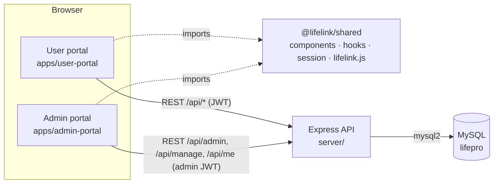

# LifeLink Pro — Architecture

Status: describes the code as delivered on 2026-10-27 (after the portal split).

## 1. System overview

```text
┌──────────────────────────────┐      ┌──────────────────────────────┐
│ User portal  apps/user-portal│      │ Admin portal apps/admin-portal│
│ React 19 + React Router 7    │      │ React 19 + React Router 7    │
│ dev :5173 · static build     │      │ dev :5174 · static build     │
│ session keys: token / user   │      │ session keys: lifelink.admin.*│
└──────────────┬───────────────┘      └───────────────┬──────────────┘
               │   both import @lifelink/shared (packages/shared):   │
               │   UI components · hooks · session · API client       │
               │                                                      │
               │      HTTPS · JSON · Authorization: Bearer <JWT>      │
               └──────────────────────────┬───────────────────────────┘
                                          ▼
                    ┌──────────────────────────────────────────┐
                    │ Express 5 API  server/  (:5000)           │
                    │ CORS allow-list (CLIENT_URL) · security   │
                    │ headers · request log · rate limits       │
                    │ routes → middleware → controllers →       │
                    │ services → repositories                   │
                    └──────────────────────┬───────────────────┘
                                           │ mysql2 pool, placeholders only
                                           ▼
                    ┌──────────────────────────────────────────┐
                    │ MySQL 8 · database "lifepro"              │
                    │ migrations 001 + 002 · InnoDB · utf8mb4   │
                    └──────────────────────────────────────────┘
```

The same diagram as Mermaid (renders on GitHub and most Markdown viewers):



**One backend, one database.** The admin portal has no server of its own: it calls the
same API as the user portal. Administrator rights are enforced by the API on every request
(`requireAdmin`), never by which portal sent the request.

## 2. Frontend

### Workspaces

The repository is an npm workspace (`package.json` at the root, one lockfile):

| Package | Name | Role |
|---|---|---|
| `packages/shared` | `@lifelink/shared` | Source-only package (no build step). Imported through a Vite alias `@lifelink/shared → packages/shared/src`; each portal's `vite.config.js` also dedupes `react`, `react-dom` and `react-router-dom` so there is one copy of each. |
| `apps/user-portal` | `@lifelink/user-portal` | Public pages, service forms, member area |
| `apps/admin-portal` | `@lifelink/admin-portal` | Administrator app |
| `server` | `@lifelink/server` | API |

### What lives where

| In `packages/shared/src` | Used by |
|---|---|
| `components/ui` — Button, Card, Badge, DataTable (client or server paging, sortable headers), Drawer, ConfirmDialog, SearchInput, SegmentedControl, Toolbar, states (Empty/Error/Skeleton), Toast | both |
| `components/form` — TextField, TextAreaField, PasswordField, ChoiceGroup, FormLayout | both |
| `components/account/AccountForms` — own name and password forms | user Profile, admin Account |
| `components/emergency` — EmergencyProgress (step tracker), EmergencyTimeline (history; `viewer` decides whether staff names are shown) | both |
| `components/layout` — Logo, UserMenu, AuthLayout, PageLoader, RouteEffects | both |
| `hooks` — useAsync, usePolling, useForm, useAuth, useToast, useSignOut, useDocumentTitle | both |
| `services/api.js` — axios instance (`VITE_API_URL`), adds the bearer token, raises a session-expired event on 401 | both |
| `services/lifelink.js` — **the single API contract**: every endpoint the portals call | both |
| `services/session.js` — `configureSession({ tokenKey, userKey })`, read/store/clear | both |
| `utils` — validation rules, formatting, status labels (`EMERGENCY_STEPS`, badges), error messages | both |
| `styles` — design tokens (CSS variables), global styles | both |

Portal-specific code stays in the portal: routes (`App.jsx`), layouts, pages, and in the
admin portal the resource descriptions (`components/admin/adminResources.jsx`) that drive
the generic management screen.

### Sessions

Each portal calls `configureSession` in its `main.jsx`:

| Portal | localStorage keys |
|---|---|
| User portal | `token`, `user` (unchanged from the original app, so existing sessions keep working) |
| Admin portal | `lifelink.admin.token`, `lifelink.admin.user` |

In production the portals run on different origins, so their storage is separate anyway;
in development they are both `localhost` but different ports (also separate origins). The
distinct key names keep them apart even if both were ever served from one origin. A member
signed in to the user portal is **not** signed in to the admin portal, and the admin portal
refuses accounts whose role is not `admin`.

### Data loading

- `useAsync(loader)` runs a loader, keeps the previous data while reloading, and exposes
  `loading / failed / error / reload / setData`.
- Lists in the admin portal are **server-driven**: page, page size (25), search text,
  filter and sort are sent to `GET /api/manage/:resource` and kept in the URL
  (`?page=2&q=city&status=Pending&sort=name&order=asc`) so a view can be reloaded or linked.
  Filter counts come from the API's `facets`.
- **Updates are polled**, not pushed: `usePolling(reload, ms)` reloads while the tab is
  visible (My requests / My assignments / emergency detail every 30 s, dashboards every
  60 s) and once when the tab becomes visible again. There is no WebSocket or SSE.

## 3. Backend

```text
server.js
  requestLogger · securityHeaders · cors(CLIENT_URL) · express.json · flat-body check
  /api/auth       authRoutes       (rate limited)
  /api/emergency  /api/blood  /api/food  /api/volunteer   public forms (+ admin-only lists)
  /api/events     /api/hospital  /api/ambulance          public lists and forms
  /api/me         meRoutes         requireUser
  /api/admin      adminRoutes      requireAdmin
  /api/manage     manageRoutes     requireAdmin
  404 JSON · errorHandler
```

| Layer | Folder | Responsibility |
|---|---|---|
| Routes | `routes/` | URL + method → middleware chain → controller |
| Middleware | `middleware/` | `auth.js` (`requireUser`, `requireAdmin`, `optionalAuth`), `security.js` (headers, request log, rate limits), `validateIdParam`, `errorHandler` |
| Controllers | `controllers/` | Read the request, call a service, shape the response (response shapes kept compatible with the original API) |
| Services | `services/` | Business rules: `emergencyService` (workflow), `userService` (accounts, password policy), `eventService` (participation), `fields.js` (validation specs), `resources.js` (what each admin resource may do) |
| Repositories | `repositories/` | SQL only: `resourceRepository` (generic list/find/insert/update/remove with whitelisted identifiers), `emergencyRepository`, `transaction.js` |
| Utils | `utils/` | `HttpError` helpers, `validateFields`, `parseListQuery` / `likePattern` |

Expected failures throw `HttpError` (400/401/403/404/405/409/429); Express 5 forwards async
errors to `errorHandler`, which returns `{ success: false, message }`. Unexpected errors are
logged on the server and answered with a generic `Internal server error`.

### Authentication and authorisation

- `POST /api/auth/login` returns a JWT (HS256, 7 days) containing `{ id, role }`.
- `requireUser` / `requireAdmin` verify the token (algorithm pinned to HS256) **and reload
  the account from the database** on every request. A deleted account is rejected at once.
- `requireAdmin` requires the `admin` role in **both** the token and the database:
  demotion takes effect immediately; a newly promoted user must sign in again to get a
  token that carries the admin role.
- `optionalAuth` links public form submissions to the signed-in account when a valid token
  is sent; an invalid token is rejected (401) rather than silently ignored.

## 4. Emergency workflow

```text
             assign volunteer / admin "Accept"
  Pending ───────────────────────────────────► Accepted ──► In Progress ──► Resolved
     │                                            │              │
     └──────────────── Cancelled ◄────────────────┴──────────────┘
```

| Transition | Who may make it |
|---|---|
| Pending → Accepted | Administrator (directly, or automatically by assigning a volunteer) |
| Accepted → In Progress | Administrator, or the assigned volunteer ("Start helping"); requires an assigned volunteer |
| In Progress → Resolved | Administrator, or the assigned volunteer ("Mark resolved") |
| Pending → Cancelled | The requester (their own request) or an administrator |
| Accepted / In Progress → Cancelled | Administrator |
| Resolved, Cancelled | Final: no further changes, no reassignment |

Rules enforced in `server/services/emergencyService.js`, inside a transaction that locks
the row (`SELECT … FOR UPDATE`) so two people cannot change the same request at once:

- A volunteer can be assigned, reassigned or removed only while the request is active; a
  volunteer cannot be *removed* while the request is In Progress (reassigning is allowed).
- Every change writes a row to `emergency_updates` (action, from/to status, actor role and
  a snapshot of the actor's and volunteer's names, optional note). The history survives
  later deletion of the user or volunteer.
- Requesters and volunteers see the history with roles only ("by a coordinator", "by the
  volunteer"); administrators see names.
- Duplicate protection (400 "Emergency request already exists.") applies only while an
  identical request (same name, phone and location) is still active; once it is resolved
  or cancelled the same person can ask for help again.

## 5. Data ownership links (migration 002)

```text
users ─┬─< emergencies.user_id            (requester; SET NULL on user delete)
       ├─< blood_donors.user_id           (SET NULL)
       ├─< food_donations.user_id         (SET NULL)
       ├─── volunteers.user_id  UNIQUE    (one volunteer profile per account; SET NULL)
       └─< event_participants.user_id     (CASCADE)
volunteers ─< emergencies.assigned_volunteer_id   (SET NULL)
events ─< event_participants.event_id             (CASCADE)
emergencies ─< emergency_updates.emergency_id     (CASCADE)
```

Submissions made while signed out are not linked (`user_id` NULL). See
[../database.md](../database.md) for every column.
